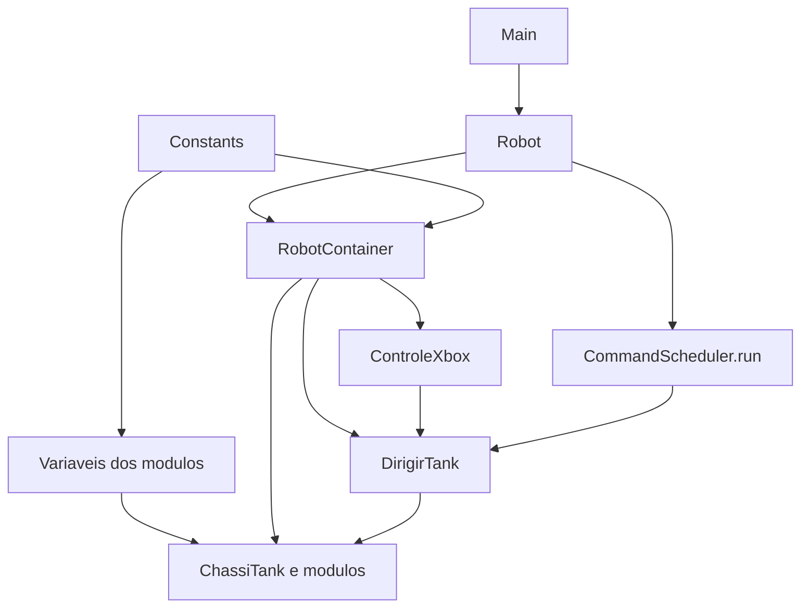

# Arquitetura e ciclo do robô

## Quem faz o quê

| Arquivo | Responsabilidade |
| --- | --- |
| `Main.java` | Iniciar o robô WPILib |
| `Robot.java` | Executar o ciclo e o scheduler |
| `RobotContainer.java` | Criar e conectar subsistemas, controles e comandos |
| `Constants.java` | Concentrar IDs, PIDs e ajustes de acesso rápido |
| `subsystems/ChassiTank.java` | Possuir motores e giroscópio da tração |
| `commands/DirigirTank.java` | Traduzir o controle em comando de pilotagem |
| `luverlib/` | Implementar os módulos reutilizáveis |

## Durante a inicialização

Os dispositivos são criados uma vez. `RobotContainer` cria o `ChassiTank`, o Xbox e sua telemetria. Depois associa `DirigirTank` como comando padrão do chassi. As classes `Variaveis*` montam configurações a partir de `Constants`.

## Durante o ciclo

`Robot.robotPeriodic()` chama `CommandScheduler.getInstance().run()`. O scheduler atualiza subsistemas registrados e executa comandos agendados. `DirigirTank` só comanda movimento em teleop habilitado, com controle conectado; ao ser encerrado, manda parar.

Ao entrar em Disabled, `Robot.disabledInit()` cancela os comandos e para a vibração. O exemplo não implementa agendamento de um seletor em `autonomousInit()` nem seu cancelamento em `teleopInit()`; essa integração aparece em [Preparar autonomo](../04%20-%20Tutoriais/Preparar%20autonomo.md).

## Regras para novas integrações

Crie motores, câmeras, publicadores e configuração fora do periódico. Um subsistema deve possuir seus dispositivos; outros módulos podem recebê-los emprestados. Ao encerrar, feche publicadores e coordenadores antes dos dispositivos que eles consultam. `AutoCloseable` fornece `close()`, mas isso não significa fechar tudo ao entrar em Disabled: o robô pode ser habilitado novamente.

O código da biblioteca oferece operações e dados. A ligação entre sensores, estimador, comandos e hardware continua sendo responsabilidade do programa do robô.

---

← [Página inicial](../00%20-%20Comece%20aqui.md) · [Fontes e versão deste guia](../05%20-%20Referencia/Fontes%20e%20versao.md)
